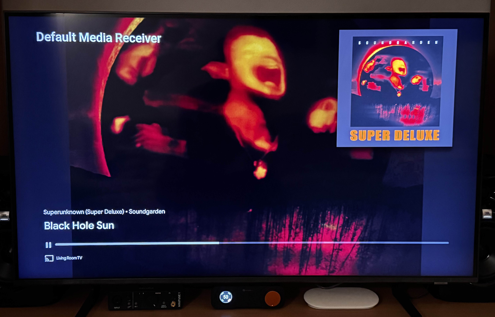
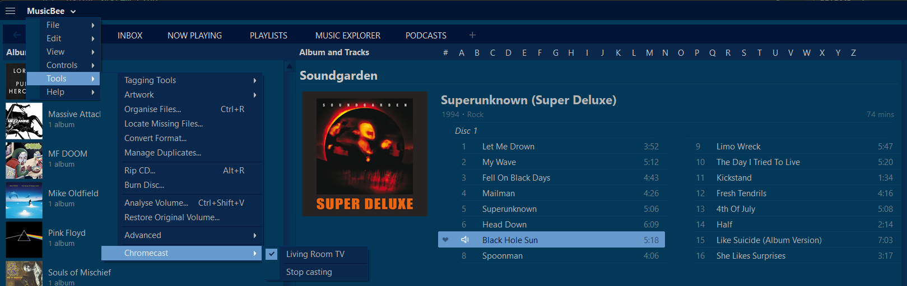

# MusicBee Chromecast

Play MusicBee's music on a Chromecast, a speaker group, or a TV with Chromecast built-in. It's one small C# file and needs nothing else installed.

MusicBee stays in charge. While casting, it plays muted and the Chromecast follows its track changes, play/pause, seeking and volume. The TV shows the title, artist, album and cover art. Pausing from the TV remote or a phone pauses MusicBee too.

## Install

1. Run `build.cmd` (it uses the C# compiler that comes with Windows), or download `mb_Chromecast.dll` from Releases.
2. Copy `mb_Chromecast.dll` into `C:\Program Files (x86)\MusicBee\Plugins` and restart MusicBee.
3. Optional: to get a toolbar button, right-click the toolbar, choose **Configure Toolbar**, add a button and set its command to **Chromecast**.

## Use

Click the toolbar button, or open **Tools → Chromecast**. Pick a device to start casting, or click **Stop casting** to stop.

The first time you cast, Windows asks whether MusicBee may use the network. Allow it on private networks, because the Chromecast streams the files from your PC.

### Volume on TVs with a sound system

Many TVs report a fixed volume to Chromecast, for example when the sound goes to a soundbar or receiver over HDMI-CEC. MusicBee's volume slider can't change those. On Android TV and Google TV you can add toolbar buttons (or hotkeys) for the **Chromecast: Volume Up** and **Chromecast: Volume Down** commands instead. They press the TV's own volume keys, the same way the remote does. The first press pairs MusicBee with the TV: the TV shows a code and MusicBee asks you to type it in. This happens only once.

## Limits

- The file is streamed as-is, so it has to be in a format the Chromecast can play: MP3, AAC/M4A, FLAC, Ogg/Opus or WAV. WMA, APE and DSD won't play.
- It uses Google's Default Media Receiver. The TV shows that name with the cover art and track info, and there's no visualizer. Showing "MusicBee" instead needs a receiver app registered with Google; set its ID as `AppId` in `Chromecast.cs`.
- The Chromecast runs a second or two behind MusicBee, so the last moment of each track can get cut off.

## Troubleshooting

If something doesn't play, `%APPDATA%\MusicBee\Chromecast.log` shows what was sent to the Chromecast, what it answered, and which files it fetched. The log starts over each time MusicBee starts.

Based on the original plugin by [Troy Fernandes](https://github.com/TroyFernandes/MusicBeeChromecast).
